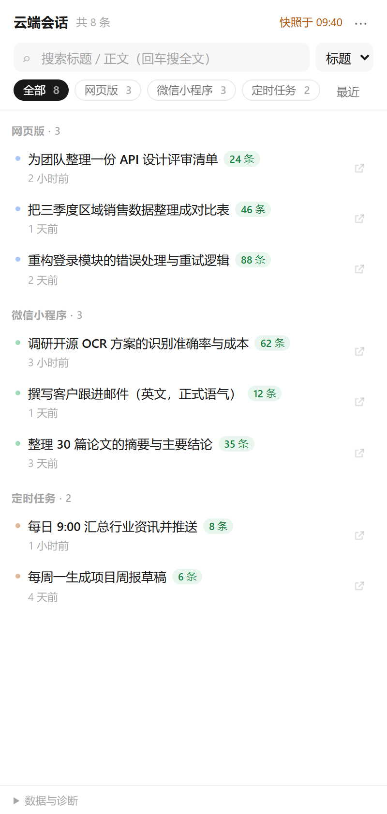
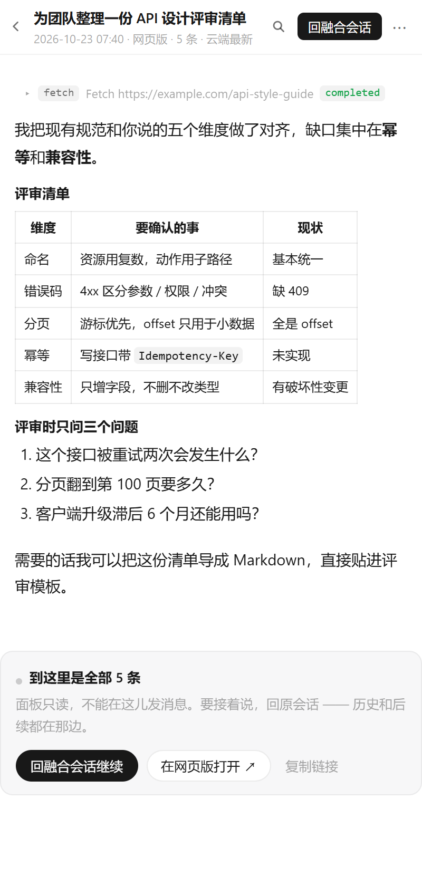
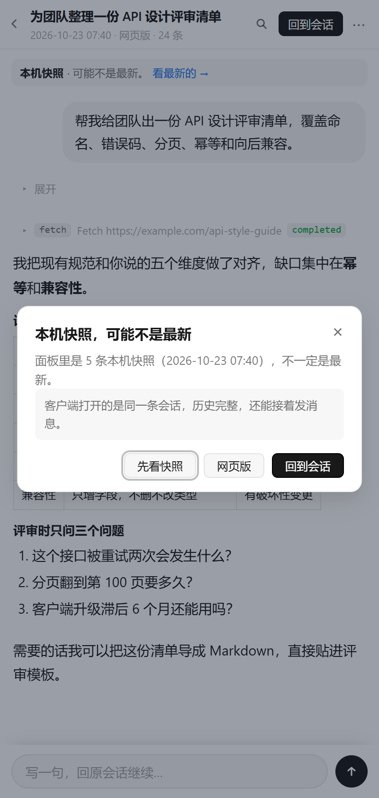
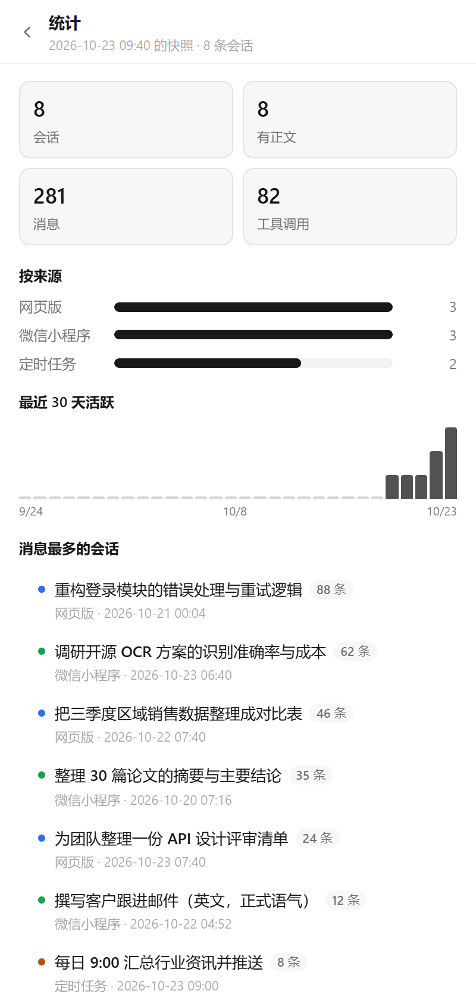
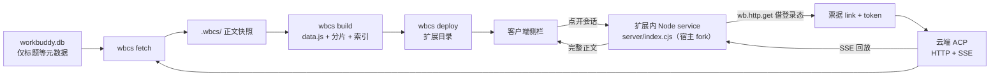

# WorkBuddy 云端会话

把 WorkBuddy **桌面端看不见的云端会话**（网页版 / 微信小程序 / 定时任务）搬进侧栏：**点进去就是从云端回放的最新全文**，可搜索、可导出，还能一键跳回原会话接着聊。

**[⬇ 下载 Windows 便携版](https://github.com/yhm138/workbuddy-cloud-sessions/releases/latest)** —— 解压后双击 `安装.bat`，不用装 Node。

<p align="center">
  
  
</p>

<p align="center">
  <sub>左：按来源分组的会话列表　·　右：完整正文渲染（表格 / 工具调用 / 思考过程）</sub>
</p>

<p align="center">
  
  
  
</p>

---

## 它解决什么问题

WorkBuddy 桌面客户端里，`DesktopCloudTaskEntry` 这个特性开关在打包时被写死成 `false`：

```js
createProductFeatureHook({ featureKey: 'DesktopCloudTaskEntry', resolve: () => false })
```

结果就是侧栏永远不请求 `cloud` 空间的会话。而本地 `workbuddy.db` 里**只有标题这类元数据，正文一份都没落盘** —— 正文只存在云端，靠 ACP 协议回放。

于是网页版 / 小程序 / 定时任务里跑过的对话，在客户端里等于消失了。

这个项目做四件事：

1. **抓**：用你自己的登录态，把云端正文完整拉下来（ACP over HTTP + SSE），做成离线快照
2. **建**：生成一份零依赖的静态页面（列表 + 全文搜索 + 正文分片）
3. **装**：作为内置扩展装回客户端侧栏，选中即读，不用等网络
4. **连**：扩展里再 fork 一个 Node service，借用**宿主自己的登录态**现场回放云端 —— 于是点开就是最新，快照退居兜底

> 全程只读，不改数据库、不改 `app.asar`。抓的是你自己的账号、你自己的会话。

---

## 功能

| | 说明 |
| --- | --- |
| **云端直连** | 扩展内跑一个 Node service，替你回放云端会话：**不用扫码、不用浏览器 profile**，点开就是最新全文 |
| **按来源分组** | 网页版 / 微信小程序 / App / 定时任务，各带条数徽标 |
| **完整正文** | 用户右侧浅块、助手文档流；标题、列表、**表格**、代码块正常渲染 |
| **工具调用折叠** | `fetch` / `execute` / `search` 收成一行，点开看输入与输出 |
| **全文搜索** | 跨会话搜正文，命中高亮，点进去自动滚到那条消息 |
| **会话内查找** | `Ctrl+F`，上/下跳转，命中计数 |
| **回融合会话** | 用 `workbuddy://chat/<id>` 深链让客户端跳到这条会话本身，在同一个 Session 里接着聊 |
| **网页版兜底** | 小程序 / App 来源在客户端里是空壳，主入口直接给网页版（系统浏览器） |
| **在线同步** | 走宿主网络通道拉最新列表，显示「同步于 hh:mm」 |
| **自动同步** | 每次点进面板自动拉一遍云端列表（60 秒节流），新会话顺手补正文，不用手动点 |
| **补全正文** | `⋯ → 补全云端正文`，把还没有正文的会话逐条从云端回放下来（带进度条，可中断） |
| **落地卡** | 直连不可用、云端也确实没有正文时，不挖坑：一个主按钮回原会话，另有网页版兜底 |
| **导出** | 单条复制为 Markdown，或全量导出到 `export/` |
| **收藏 / 排序 / 统计** | 收藏置顶、按时间或条数排序、来源分布与 30 天活跃曲线 |
| **深链** | `#/s/<id>` 直达某条会话，可当书签 |

<p align="center">
  
  
</p>

<p align="center">
  <sub>左：快照提醒（点遮罩不关闭，必须显式确认）　·　右：来源分布与活跃度统计</sub>
</p>

> 截图为 `tools/demo-shots.js` 生成的示例数据，**不含任何真实会话**。

快捷键：`/` 搜索 · `↑↓` 选择 · `Enter` 打开 · `Esc` 返回 · `Ctrl+F` 会话内查找 · `?` 统计

---

## 下载即用（不想碰命令行）

到 [Releases](https://github.com/yhm138/workbuddy-cloud-sessions/releases/latest) 下载 `workbuddy-cloud-sessions-<版本>-win-x64.zip`（约 36 MB），解压到任意目录：

1. **先完全退出 WorkBuddy**：右下角托盘图标右键 → 退出（只关窗口不算）
2. **双击 `install.bat`**（中文名 `安装.bat` 是同一个东西），跟着窗口里的中文提示走：
   - 第一次会让你扫码登录网页版（微信扫一下，登录态长期复用）
   - 问抓多少条，默认「最近 30 条」，几分钟内完成
3. 打开 WorkBuddy → 左侧菜单点「云端会话」

包里自带 Node 运行时，**不用装 Node、不用 npm install**；浏览器复用系统 Chrome / Edge（Windows 自带 Edge）。
卸载双击 `uninstall.bat`，会问你顺带删不删登录态。

> 安装在客户端目录里（`resources/app.asar.unpacked/resources/extensions/cloud-sessions`）。
> 数据放在 `%LOCALAPPDATA%\wbcs`，重新解压新版本不会丢。

---

## 从源码安装

前置：Node 18+（抓正文建议 22+，读 SQLite 用的是内置 `node:sqlite`），WorkBuddy 桌面端已登录过一次。macOS / Linux 走这条路。

```bash
git clone https://github.com/yhm138/workbuddy-cloud-sessions.git
cd workbuddy-cloud-sessions
npm install
node bin/wbcs.js install             # 向导：查环境 → 登录 → 抓取 → 构建 → 部署
```

分步来也行（`npx playwright install chromium` 只在系统里既没 Chrome 也没 Edge 时才需要）：

```bash
node bin/wbcs.js login               # 弹浏览器，扫码一次，登录态长期复用
node bin/wbcs.js fetch --limit 30    # 抓正文
node bin/wbcs.js build               # 生成静态数据
node bin/wbcs.js deploy              # 装进客户端
```

然后**完全退出** WorkBuddy（托盘图标右键退出，只关窗口不够）再打开，左侧菜单会多一项「云端会话」。

只想先看效果、不装扩展：

```bash
node bin/wbcs.js fetch --limit 5
node bin/wbcs.js build
node bin/wbcs.js serve               # http://127.0.0.1:8787/
```

---

## 命令

| 命令 | 作用 |
| --- | --- |
| `wbcs install` | 一键向导：查环境 → 登录 → 抓取 → 构建 → 部署（`--yes` 全默认，`--skip-fetch` 只装面板） |
| `wbcs uninstall` | 从客户端移除扩展，可顺带删 `WBCS_HOME` |
| `wbcs login` | 扫码登录，登录态存到 `.wbcs/profile`（Playwright 持久 profile） |
| `wbcs list` | 只读本地 DB，列出有哪些云端会话（不联网） |
| `wbcs fetch` | 抓正文，支持 `--limit N` / `--only id1,id2` / `--force` / `--idle 4000` |
| `wbcs build` | 生成 `ui/data.js` + `ui/full/*.js` 分片 + 搜索索引 |
| `wbcs deploy` | 装进客户端扩展目录（自动探测，可 `--dest`）；客户端在跑会拒绝，`--force` 强制热更新 |
| `wbcs export` | 导出 Markdown 到 `export/`（含 `INDEX.md`） |
| `wbcs serve` | 本地静态预览，`--port` 改端口 |
| `wbcs all` | `fetch` + `build` + `deploy` |
| `npm run release` | 打 Windows 便携包（自带 node.exe），产物在 `dist/` |

环境变量：

| 变量 | 说明 |
| --- | --- |
| `WBCS_HOME` | 数据目录，默认 `<repo>/.wbcs` |
| `WBCS_DB` | `workbuddy.db` 路径，默认 `~/.workbuddy/workbuddy.db` |
| `WBCS_EXT_DIR` | 扩展目录，跳过自动探测 |
| `WORKBUDDY_RESOURCES_PATH` | WorkBuddy 的 `resources` 目录 |
| `WBCS_DEBUG` | 打印详细诊断 |

---

## 工作原理



两条路并存：**快照负责「打开就有、离线可读、可搜索导出」，service 负责「打开就是最新」**。service 没起来（老版本客户端、fork 被拦）时面板自动退回快照模式，行为跟 v1.8.0 一致。

正文不走 REST，走 **ACP（Agent Client Protocol）over HTTP + SSE**：

1. `GET /console/as/conversations/{id}/session` → 拿到消息服务地址 `link` 和沙箱 JWT
2. `GET {link}`，`accept: text/event-stream` 建 SSE 长连接 → **响应头下发 `acp-connection-id`**
3. `POST {link}` 发 `initialize` + `session/load`，历史以 `session/update` 事件回放

最容易踩的坑：不带 `acp-connection-id` 的 POST 一律 `404 connection not found`；SSE 没 ready 就 POST 也一样。

### 云端直连（扩展内 service）

面板是个 iframe，在浏览器里拉正文走不通：ACP 网关不回 `access-control-allow-origin`，也不 expose `acp-connection-id`，`fetch` 一律被 CORS 拦死。

所以扩展声明了一个 fork 出来的 Node service（`server/index.cjs`）：

1. 宿主 fork 子进程并调 `activate(wb)`；`wb.http.get` **自带宿主的登录 cookie**
2. `GET /console/as/conversations/{id}/session` 换 `{link, token}` —— **不用扫码，也不依赖 Playwright profile**
3. 这个进程是真 Node，`https` 建 SSE 没有 CORS，POST 带上 `acp-connection-id` 就能回放
4. 面板侧：`wb:extensions:$resolveLocalRpc` 拿票据 → `$invokeLocalRpcFallback` 调 `fetchBody`

并发闸门 2 条、内存缓存 3 分钟、票据过期自动重换；service 起不来时整套降级回快照模式。
v1.10 起回放是**流式**的：`fetchBody` 之外多了一个 `peek`，面板每 280ms 取一次已解析的消息，
边拉边画（实测把「空转 4 秒」压到「1 秒见正文」）。
协议细节（票据字段、`activate` 返回值、`processPolicy` 写法、踩过的坑）见 PROTOCOL.md 6.9 / 6.10。

字段、事件类型、扩展加载规则、深链与握手的实现细节，都在 **[docs/PROTOCOL.md](docs/PROTOCOL.md)**。

---

## 面板里能做什么、不能做什么

面板是**只读的浏览层**，不是第二个聊天客户端。这条边界值得先讲清楚：

| 能力 | 面板内 | 说明 |
| --- | --- | --- |
| 读「最新」正文 | ✅ service 在跑时 | 点开就从云端回放，正文顶上标「云端最新 · hh:mm（N 个事件）」；**回放中边拉边画**，第一段正文 1 秒内到 |
| 读历史正文 | ✅ 退回本机快照 | service 不可用时自动降级，标「本机快照 · 可能不是最新」并弹一次说明 |
| 小程序 / 网页版会话正文 | ✅ service 在跑时 | 客户端自己打开这类会话是空的（「暂无对话记录」），面板能直接回放，主按钮也会改成「网页版继续」 |
| 全文搜索 | ✅ 快照 + 已直连拉过的 | 搜的是「手上已有的正文」：`wbcs fetch` 的快照，加上本次面板里从云端拉回来的 |
| 继续对话 | ✅ 两条路 | 正文末尾的卡片 / 顶栏按钮：**回融合会话**（`workbuddy://chat/<id>` 深链，同一个 Session）或**网页版**（系统浏览器）。面板本身不提供输入 |
| 在面板里发消息 | ❌ 不做 | 不是偷懒：宿主的 `wb:message:fill` 只会往「新建草稿」里塞、并清空当前会话 id，跳过去输入框是空的。与其假装能输入，不如把「去哪儿说」写清楚 |
| 重复打开同一条 | ⚡ 秒开 | 3 分钟内直接命中缓存；云端 `updatedAt` 没变的话 30 分钟内都复用 |

所以界面里会看到两种顶部提示，别混淆：

- 「**云端最新** · hh:mm 从云端回放」——这是真·最新
- 「**本机快照** · 可能不是最新」——service 没起来时的降级，进详情会弹一次说明（**点遮罩不关闭**，必须点 `✕` / 「先看快照」/ 按 `Esc`）

把这两个提示合并成一种，人就会把半截快照当成完整对话 —— 这比看不到更糟。

---

## 数据与隐私

- 登录态、抓取结果、导出文件都在 `.wbcs/` 和 `export/`，**已被 `.gitignore` 排除**
- 构建产物 `ui/data.js`、`ui/full/` 同样不提交
- README 截图由 `node tools/demo-shots.js` 用**内置示例数据**渲染，不读你的库
- 全程只读：不改 `workbuddy.db`，不改 `app.asar`（改二进制会导致客户端启动闪退，别试）
- 唯一写入的地方是扩展目录 `…/app.asar.unpacked/resources/extensions/cloud-sessions/`

---

## 目录结构

```
bin/wbcs.js            CLI 入口
src/config.js          路径与平台探测（扩展目录自动发现）
src/db.js              读 workbuddy.db（node:sqlite，只读）
src/browser.js         浏览器兜底链：Chrome → Edge → 本机 Chromium → 自带
src/auth.js            Playwright 持久登录
src/acp.js             ACP over HTTP + SSE 客户端（CLI 用）
src/parse.js           session/update → 扁平面条结构（CLI 用）
src/fetch.js           全量抓取（增量、原子落盘）
src/build.js           生成 data.js / 正文分片 / 搜索索引
src/deploy.js          安装为内置扩展
src/install.js         一键安装 / 卸载向导
src/serve.js           本地预览服务
src/export.js          Markdown 导出
server/index.cjs       扩展内 service（宿主 fork）：票据 → SSE → 分片
server/acp.cjs         ACP 客户端（CJS，service 与 CLI 共用同一份逻辑）
server/parse.cjs       事件解析（同上）
ui/index.html          扩展页面（零依赖，纯原生 JS）
tools/build-release.js 打 Windows 便携包（自带 node.exe）
tools/release/         安装包里的 install.bat / uninstall.bat / 使用说明
tools/demo-shots.js    用示例数据生成 README 截图
test/handshake.html    假宿主，验证 guest-ready 握手
test/run-handshake.js  一键跑握手指令自检
test/mock-gateway.cjs  假 ACP 网关（联网零依赖，自测用）
test/service-acp.js    service 端到端自测（票据 / 回放 / 缓存 / 失败分支）
test/panel-service.js  面板 + service 联调（Playwright，假宿主 + 假网关）
extension.json         扩展清单（含 service 声明）
distribution.json      分发清单（builtin + iframe + processPolicy）
docs/PROTOCOL.md       协议与机制逆向笔记
```

---

## 开发

```bash
npm test                    # guest-ready 握手自检（真实 Chrome/Edge）
npm run test:service        # service 端到端自测（假网关，不联网、不用登录）
npm run test:panel          # 面板 + service 联调（Playwright，假宿主；NO_SERVICE=1 测降级）
npm run release             # 生成 dist/*-win-x64.zip（需要 unzip / zip 命令）
node tools/demo-shots.js    # 重新生成 docs/images/*.png
```

版本号必须五处一致：`package.json`、`extension.json`、`distribution.json`、
`server/index.cjs` 的 `VERSION`（部署目录里没有 package.json，service 只能写死），
以及页面里的 `PAGE_VERSION`（宿主按清单版本给 iframe 打 `?v=`，不一致时面板会提示「重启即可」）。
`wbcs build` 与 CI 都会校验这几处。

---

## 常见问题

**`no_token_401` / 登录态失效**
重新 `wbcs login`。Playwright profile 里的 cookie 有有效期，通常能撑很久。

**某条会话点开是空的**
纯定时任务的会话本来就没有对话记录，页面会明确提示。要么点「从云端拉最新正文」再试，要么 `wbcs fetch --only <id>` 补，要么走卡片里的「回到会话 / 网页版」。

**正文顶部写的是「本机快照」，不是「云端最新」**
说明 service 没起来，面板降级了。看页面底部「数据与诊断」的「云端直连」一行，`不可用 —— …` 后面就是原因。常见三种：

1. 扩展目录是旧版本（重新 `wbcs deploy`，然后**完全退出客户端**再打开）
2. 客户端版本不支持扩展 service（`extension.json` 的 `service` 被忽略）
3. fork 被安全软件 / 企业策略拦掉

**「云端直连」显示活着的版本号，但拉正文报 `NO_TICKET`**
宿主的登录态过期了。在客户端里随便打开一个会话、或重新登录一次，再点「从云端拉最新正文」。
这条链路借的是**客户端自己的 cookie**，不读 `.wbcs/profile`，所以 `wbcs login` 对它没影响。

**面板提示「插件加载失败，请检查网络后重新加载」**
两种原因，看页面底部「数据与诊断」区分：

1. `Guest Ready timed out after 10000ms` → 扩展没在 10 秒内完成握手（v1.0.2 已修）
2. 资源 404 / 纯空白 → 宿主在启动时缓存了扩展文件快照，运行期替换目录后仍按旧快照取文件。**完全退出客户端再打开**即可。

**「回到会话」点了没反应**
用的是 `workbuddy://chat/<id>` 深链。注意别用 `wb:message:fill` 代替 —— 它只是往 composer 事件流推一把，等于在**新草稿**里续，不是同一条会话。

**装进客户端后菜单里没有**
`wbcs deploy` 会自动探测安装目录，失败时用 `--dest` 指定到 `…/app.asar.unpacked/resources/extensions`。装完必须完全退出客户端再打开。

**双击 `安装.bat` 窗口一闪就没了**
`runtime\node.exe` 没解出来。重新下载 zip，用「全部解压」而不是把里面的文件拖出来。

**安装时提示需要管理员权限**
客户端装在 `C:\Program Files` 下就是这样。右键 `安装.bat` → 「以管理员身份运行」。

**第一次扫码时弹不出浏览器**
需要系统里有 Chrome 或 Edge（Windows 自带 Edge）。两者都没有时执行 `npx playwright install chromium`。

---

## 声明

非官方工具，与 WorkBuddy 官方无关，靠逆向客户端行为实现，仅用于读取**自己账号**的历史会话。

如果官方后续开放了云端会话入口，这个项目就该退休了 —— 那才是正确的解法。

[MIT License](LICENSE)
